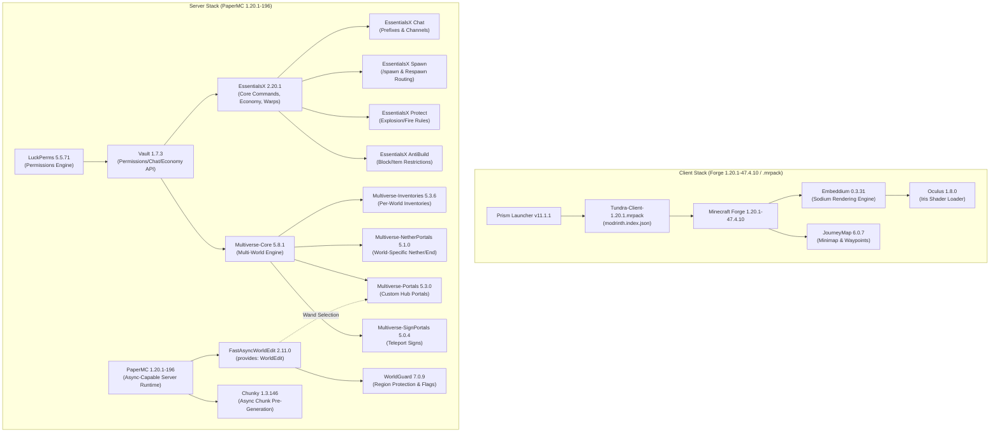

# Tundra

Declarative package manifest, `uv`-style compatibility/dependency resolver, and automated downloader for a pinned **Minecraft 1.20.1** server and client stack — part of the **Frost** ecosystem.

Instead of committing heavy `.jar` and `.exe` binaries into Git history or manually hunting through plugin READMEs to check compatibility, **Tundra** declares every server runtime, client mod, and plugin in [`packages.tsv`](./packages.tsv) with pinned versions, SHA256 checksums, upstream CDN URLs, and architectural purpose, paired with [`download.sh`](./download.sh) and [`modrinth.index.json`](./modrinth.index.json).

---

## Architecture & Dependency Graph

The server runs **PaperMC `1.20.1-196`** with **FastAsyncWorldEdit (FAWE)**, **WorldGuard**, **LuckPerms**, **Vault**, **EssentialsX**, and **Multiverse 5.x**, while the client bundle provides **Embeddium** (Sodium port) + **Oculus** (Iris Shaders port) + **JourneyMap** on **Minecraft Forge `1.20.1-47.4.10`**, packaged as a one-click **Modrinth `.mrpack`** for **Prism Launcher**.



---

## Dependency & Compatibility Resolution ("`uv` for Minecraft")

You never need to read plugin/mod READMEs manually to figure out what is compatible with what or which version supports a given Minecraft release. Minecraft's ecosystem exposes two machine-readable metadata layers, both automated by [`./download.sh`](./download.sh):

### 1. Upstream Registry Resolution (`./download.sh --resolve`)
Queries the **Modrinth v2 Bulk API**, **PaperMC Fill v3 API**, and **Forge Maven Promotions API** (`curl` + `jq`) in seconds to verify:
- **Game Version & Loader Matrix**: Confirms every pinned version explicitly supports the target Minecraft version (`1.20.1` by default) and runtime loader (`paper`/`spigot`/`bukkit` on server, `forge`/`neoforge` on client).
- **Typed Dependency Edges**: Validates `required` dependencies (e.g. `Oculus` $\rightarrow$ `Embeddium`, `WorldGuard` $\rightarrow$ `WorldEdit`, `Multiverse-*` $\rightarrow$ `Multiverse-Core`), virtual `provides` satisfaction (`FastAsyncWorldEdit` $\rightarrow$ `WorldEdit`), and `incompatible` conflicts (e.g. `Embeddium` $\not\leftrightarrow$ `Rubidium`).
- **Upgrade Simulation (`--mc <VERSION>`)**: Run `./download.sh --resolve --mc 1.21.1` at any time to preview upgrading the server — it queries upstream registries and prints the exact latest compatible release of every mod and plugin for that target Minecraft version.

### 2. Offline `.jar` Manifest Inspection (`./download.sh --inspect-deps`)
Every Bukkit/Paper plugin `.jar` embeds a `plugin.yml` (or `paper-plugin.yml`) and every Forge mod `.jar` embeds `META-INF/mods.toml`. Running `./download.sh --inspect-deps` streams these internal manifests directly out of the `.jar` archives using `7z` (without extracting files to disk) and verifies:
- `api-version` / `versionRange` constraints
- Virtual package providers (`FastAsyncWorldEdit` declares `provides: [WorldEdit]`; `Oculus` declares `provides = ["iris"]`)
- Hard load-time dependencies (`depend` / mandatory `[[dependencies]]`) and optional integrations (`softdepend`)

---

## Quick Start (`download.sh`)

```bash
# 1. Resolve upstream MC 1.20.1 compatibility, dependency graph, and latest versions
./download.sh --resolve

# 2. Preview what versions would be needed to upgrade the stack to another MC version
./download.sh --resolve --mc 1.21.1

# 3. Download all 21 packages, verify SHA256 hashes, and generate Tundra-Client-1.20.1.mrpack
./download.sh

# 4. Inspect embedded plugin.yml and META-INF/mods.toml inside downloaded .jar files
./download.sh --inspect-deps

# 5. List all declared packages, local verification status, and why they exist
./download.sh --list

# 6. Verify SHA256 checksums of existing local files without downloading
./download.sh --verify

# 7. Download only server runtime, only server plugins, or only client mods/tools
./download.sh --server
./download.sh --plugins
./download.sh --client
```

### One-Click Client Setup via Prism Launcher (`.mrpack`)

Running `./download.sh` (or `./download.sh --mrpack`) packages [`modrinth.index.json`](./modrinth.index.json) into `client/Tundra-Client-1.20.1.mrpack`. Players do not need to manually run the Forge installer or copy `.jar` files:
1. Open **Prism Launcher** $\rightarrow$ **Add Instance** $\rightarrow$ **Import**.
2. Select `client/Tundra-Client-1.20.1.mrpack`.
3. Prism Launcher automatically provisions **Minecraft `1.20.1`**, installs **Forge `47.4.10`**, and downloads/verifies **Embeddium**, **Oculus**, and **JourneyMap** from Modrinth CDN.

### Archiving Binaries in a GitHub Release

All 21 verified binaries (plus `Tundra-Client-1.20.1.mrpack`) can be bundled into a single reproducible release archive:

```bash
# Creates tundra-mc1.20.1-binaries.tar.gz and SHA256SUMS after verifying all 21 files
./download.sh --bundle

# Upload the bundle and individual files to a GitHub Release using GitHub CLI:
gh release create v2.0.0 tundra-mc1.20.1-binaries.tar.gz SHA256SUMS server/* client/* plugins/* \
  --title "Tundra v2.0.0 — Modernized MC 1.20.1 Stack (Paper + FAWE + Embeddium/Oculus)" \
  --notes "Pinned Paper 1.20.1 server runtime, FAWE, Chunky, Multiverse 5.x, LuckPerms 5.5, and Forge 1.20.1 client mods (.mrpack)."
```

---

## Declared Packages & Why They Exist

### 1. Server Runtime (`server/`)

| File | Package & Version | Upstream Source | Why It Exists |
| :--- | :--- | :--- | :--- |
| `paper-1.20.1-196.jar` | **PaperMC Server** `1.20.1-196` | [PaperMC Fill v3 API](https://papermc.io/downloads/paper) | High-performance fork of Spigot/Bukkit for Minecraft `1.20.1` (final stable build `#196`). Required by **FastAsyncWorldEdit (FAWE)** and provides async chunk loading and tick optimizations while allowing both Vanilla and Forge `1.20.1` clients to connect. |

---

### 2. Client Stack (`client/`)

Client-side utilities distributed to players (individually or via `client/Tundra-Client-1.20.1.mrpack`) for high-FPS rendering, shader support, and an in-game world map without requiring server-side Forge mods.

| File | Package & Version | Upstream Source | Why It Exists |
| :--- | :--- | :--- | :--- |
| `PrismLauncher-Windows-MSVC-Setup-11.1.1.exe` | **Prism Launcher** `11.1.1` | [GitHub Releases](https://github.com/PrismLauncher/PrismLauncher/releases/tag/11.1.1) | Open-source launcher that natively imports `Tundra-Client-1.20.1.mrpack` and manages isolated Minecraft instances, Java runtimes, and Forge installations. |
| `forge-1.20.1-47.4.10-installer.jar` | **Minecraft Forge** `1.20.1-47.4.10` | [Forge Maven](https://files.minecraftforge.net/net/minecraftforge/forge/index_1.20.1.html) | Official `1.20.1-recommended` client mod loader required to load Embeddium, Oculus, and JourneyMap (for manual installs outside Prism Launcher). |
| `embeddium-0.3.31+mc1.20.1.jar` | **Embeddium** `0.3.31+mc1.20.1` | [Modrinth](https://modrinth.com/mod/embeddium) | Modern, open-source Sodium port for Forge `1.20.1` that replaces OptiFine with dramatically better frame times, chunk rendering, and mod compatibility. Required by **Oculus**. |
| `oculus-mc1.20.1-1.8.0.jar` | **Oculus** `1.20.1-1.8.0` | [Modrinth](https://modrinth.com/mod/oculus) | Modern Iris Shaders port for Forge `1.20.1` (`provides = ["iris"]`), enabling full shader pack support alongside **Embeddium**. |
| `journeymap-forge-1.20.1-6.0.7.jar` | **JourneyMap** `1.20.1-6.0.7+forge` | [Modrinth](https://modrinth.com/mod/journeymap) | Real-time HUD minimap, full-screen explored world map, cave mapping, and player waypoints/death markers. |

---

### 3. Server Plugins (`plugins/`)

Server-side plugins for **Paper `1.20.1`**, organized into four functional layers:

#### A. Permissions & Service API Layer

| File | Package & Version | Upstream Source | Why It Exists |
| :--- | :--- | :--- | :--- |
| `LuckPerms-Bukkit-5.5.71.jar` | **LuckPerms** `5.5.71` | [Modrinth](https://modrinth.com/plugin/luckperms) | The server's authority for roles, groups (Admin, Mod, Builder, Default), prefixes, and command permissions (`/lp editor`). Loads before Vault. |
| `Vault.jar` | **Vault** `1.7.3-b131` | [GitHub Releases](https://github.com/MilkBowl/Vault/releases/tag/1.7.3) | Standard service abstraction bridge that allows EssentialsX, Multiverse, and FAWE to query player groups, prefixes, and economy balances from LuckPerms. |

#### B. Core Gameplay, Chat & Moderation (`EssentialsX` Suite)

| File | Package & Version | Upstream Source | Why It Exists |
| :--- | :--- | :--- | :--- |
| `EssentialsX-2.20.1.jar` | **EssentialsX Core** `2.20.1` | [Modrinth](https://modrinth.com/plugin/essentialsx/version/2.20.1) | Provides standard survival/hub commands (`/tpa`, `/home`, `/warp`, `/back`, `/kit`, `/msg`), built-in economy, and admin moderation tools. |
| `EssentialsXChat-2.20.1.jar` | **EssentialsX Chat** `2.20.1` | [Modrinth](https://modrinth.com/plugin/essentialsx/version/2.20.1) | Formats server chat messages, injects LuckPerms group prefixes/suffixes via Vault, and supports color codes and local/global chat radius. |
| `EssentialsXSpawn-2.20.1.jar` | **EssentialsX Spawn** `2.20.1` | [Modrinth](https://modrinth.com/plugin/essentialsx/version/2.20.1) | Controls initial join locations, `/setspawn` and `/spawn` commands, and per-group respawn behavior on death. |
| `EssentialsXProtect-2.20.1.jar` | **EssentialsX Protect** `2.20.1` | [Modrinth](https://modrinth.com/plugin/essentialsx/version/2.20.1) | Lightweight global world protection rules (disabling creeper block damage, TNT explosions, fire spread, or wither griefing). |
| `EssentialsXAntiBuild-2.20.1.jar` | **EssentialsX AntiBuild** `2.20.1` | [Modrinth](https://modrinth.com/plugin/essentialsx/version/2.20.1) | Fine-grained permission checks (`essentials.build.*`) to prevent specific ranks from placing, breaking, crafting, or dropping blacklisted blocks/items. |

#### C. Multi-World & Portal Routing (`Multiverse 5.x` Suite)

| File | Package & Version | Upstream Source | Why It Exists |
| :--- | :--- | :--- | :--- |
| `multiverse-core-5.8.1.jar` | **Multiverse-Core** `5.8.1` | [Modrinth](https://modrinth.com/plugin/multiverse-core) | Allows a single server process to host multiple isolated worlds (Lobby/Hub, Survival, Creative, Minigames) with separate seeds, difficulties, and gamemodes. |
| `multiverse-inventories-5.3.6.jar` | **Multiverse-Inventories** `5.3.6` | [Modrinth](https://modrinth.com/plugin/multiverse-inventories) | Separates player inventories, health, XP, potion effects, and Ender Chests between worlds so Creative-mode items cannot be smuggled into Survival worlds. |
| `multiverse-netherportals-5.1.0.jar` | **Multiverse-NetherPortals** `5.1.0` | [Modrinth](https://modrinth.com/plugin/multiverse-netherportals) | Fixes vanilla portal routing in multi-world servers by linking each custom Overworld (`world_a`, `world_b`) to its own dedicated `_nether` and `_the_end` dimensions. |
| `multiverse-portals-5.3.0.jar` | **Multiverse-Portals** `5.3.0` | [Modrinth](https://modrinth.com/plugin/multiverse-portals) | Creates custom stargates/portals (selected with the FAWE/WorldEdit wand) in the server Hub/Lobby that teleport players to other worlds or coordinates on walk-through. |
| `multiverse-signportals-5.0.4.jar` | **Multiverse-SignPortals** `5.0.4` | [Modrinth](https://modrinth.com/plugin/multiverse-signportals) | Enables `[mv]` teleport signs and sign-defined portal destinations for quick hub navigation. |

#### D. Async World Building, Chunk Pre-Generation & Region Protection

| File | Package & Version | Upstream Source | Why It Exists |
| :--- | :--- | :--- | :--- |
| `FastAsyncWorldEdit-Bukkit-2.11.0.jar` | **FastAsyncWorldEdit (FAWE)** `2.11.0` | [Modrinth](https://modrinth.com/plugin/fastasyncworldedit) | Blazingly fast, asynchronous drop-in replacement for WorldEdit (`provides: [WorldEdit]`). Executes massive `//set`, `//paste`, brush, and schematic operations off the main server thread without stalling Paper's tick loop, while satisfying the `WorldEdit` dependency for **WorldGuard** and **Multiverse-Portals**. |
| `worldguard-bukkit-7.0.9-dist.jar` | **WorldGuard** `7.0.9` | [Modrinth](https://modrinth.com/plugin/worldguard) | Defines polygonal/cuboid 3D regions (Spawn Hub, Arena, Safezones) with granular flags (`pvp`, `build`, `mob-spawning`, `invincible`, `entry`). |
| `Chunky-1.3.146.jar` | **Chunky** `1.3.146` | [Modrinth](https://modrinth.com/plugin/chunky) | Pre-generates world chunks asynchronously (`/chunky radius 5000`, `/chunky start`) so players exploring new Survival or Multiverse worlds never cause main-thread chunk-generation lag spikes. |