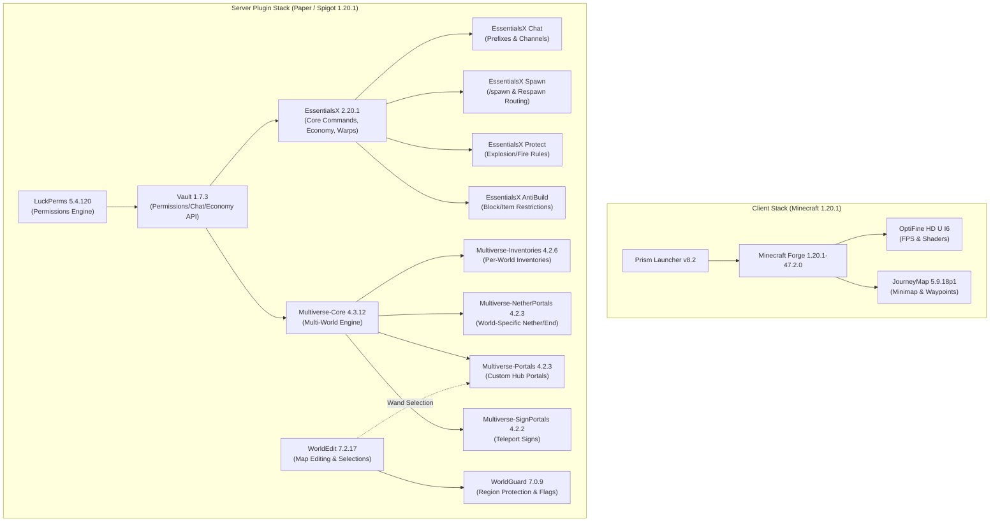

# Tundra

Declarative package manifest, architecture documentation, and automated downloader for a pinned **Minecraft 1.20.1** server and client stack — part of the **Frost** ecosystem.

Instead of committing heavy `.jar` and `.exe` binaries into Git history, **Tundra** declares every mod, plugin, and tool in [`packages.tsv`](./packages.tsv) with pinned versions, SHA256 checksums, upstream URLs, and the reason each package exists, paired with [`download.sh`](./download.sh) to fetch and verify them automatically.

---

## Architecture & Plugin Dependency Graph

The server is a **Bukkit / Spigot / Paper 1.20.1** multi-world setup (allowing Vanilla or Forge `1.20.1` clients to connect), while the client bundle provides quality-of-life mods (**JourneyMap** + **OptiFine**) running on **Minecraft Forge 47.2.0** via **Prism Launcher**.



---

## Quick Start (`download.sh`)

```bash
# 1. List all declared packages, versions, local status, and why they exist
./download.sh --list

# 2. Verify SHA256 checksums of existing files in client/ and plugins/
./download.sh --verify

# 3. Download all missing packages from upstream CDNs and verify SHA256 checksums
./download.sh

# 4. Or pull directly from the pinned Tundra v1.0.0 GitHub Release mirror
./download.sh --from-release

# 5. Download only server plugins or only client mods/tools
./download.sh --plugins
./download.sh --client
```

### Archiving Binaries in a GitHub Release

Because binary `.jar` and `.exe` files are ignored via [`.gitignore`](./.gitignore), and upstream CI servers occasionally purge old snapshot builds (such as `LuckPerms-Bukkit-5.4.120.jar`), all verified binaries are archived in the **[Tundra `v1.0.0` GitHub Release](https://github.com/SpanishSyntax/Tundra/releases/tag/v1.0.0)**.

To regenerate the release bundle locally:

```bash
# Creates tundra-mc1.20.1-binaries.tar.gz and SHA256SUMS after verifying all 18 files
./download.sh --bundle

# Upload the bundle and individual files to a GitHub Release using GitHub CLI:
gh release create v1.0.0 tundra-mc1.20.1-binaries.tar.gz SHA256SUMS client/* plugins/* \
  --title "Tundra v1.0.0 — MC 1.20.1 Binary Snapshot" \
  --notes "Pinned client mods and server plugins for Minecraft 1.20.1"
```

> [!NOTE]
> When running `./download.sh`, 17 of the 18 packages download directly from their original upstream CDNs (including automated session-token extraction for **OptiFine**), and `LuckPerms-Bukkit-5.4.120.jar` automatically falls back to the **Tundra `v1.0.0` GitHub Release** mirror (or Modrinth's archived `5.4.145` build if `--allow-fallback` is passed).

---

## Declared Packages & Why They Exist

### 1. Client Stack (`client/`)

Client-side utilities distributed to players so they can launch a pre-configured `1.20.1` instance with shaders, performance improvements, and an in-game map without requiring server-side Forge mods.

| File | Package & Version | Upstream Source | Why It Exists |
| :--- | :--- | :--- | :--- |
| `PrismLauncher-Windows-MSVC-Setup-8.2.exe` | **Prism Launcher** `8.2` | [GitHub Releases](https://github.com/PrismLauncher/PrismLauncher/releases/tag/8.2) | Lightweight, open-source launcher that manages isolated Minecraft instances, Java runtimes, and Forge installations cleanly. |
| `forge-1.20.1-47.2.0-installer.jar` | **Minecraft Forge** `1.20.1-47.2.0` | [Forge Maven](https://files.minecraftforge.net/net/minecraftforge/forge/index_1.20.1.html) | Client mod loader for Minecraft `1.20.1` required to load JourneyMap and OptiFine as a Forge mod. |
| `OptiFine_1.20.1_HD_U_I6.jar` | **OptiFine HD Ultra** `1.20.1_HD_U_I6` | [OptiFine.net](https://optifine.net/downloads) | Improves client FPS, adds dynamic lighting, zoom hotkey, connected textures, and enables shader packs. Dropped into the client's `mods/` folder alongside Forge. |
| `journeymap-1.20.1-5.9.18p1-forge.jar` | **JourneyMap** `1.20.1-5.9.18p1` | [CurseForge](https://www.curseforge.com/minecraft/mc-mods/journeymap/files/5157733) / [Modrinth](https://modrinth.com/mod/journeymap) | Provides a real-time HUD minimap, full-screen explored world map, cave mapping, and player waypoints/death markers. |

---

### 2. Server Plugins (`plugins/`)

Server-side plugins designed for a **Bukkit / Spigot / Paper 1.20.1** server, organized into four functional layers:

#### A. Permissions & Service API Layer

| File | Package & Version | Upstream Source | Why It Exists |
| :--- | :--- | :--- | :--- |
| `LuckPerms-Bukkit-5.4.120.jar` | **LuckPerms** `5.4.120` | [LuckPerms](https://luckperms.net/) / [Modrinth](https://modrinth.com/plugin/luckperms) | The server's authority for roles, groups (e.g., Admin, Mod, Builder, Default), prefixes, and command permissions (`/lp editor`). Configured to load before Vault. |
| `Vault.jar` | **Vault** `1.7.3-b131` | [GitHub Releases](https://github.com/MilkBowl/Vault/releases/tag/1.7.3) | Standard abstraction bridge that allows EssentialsX and Multiverse to query player groups, prefixes, and economy balances from LuckPerms without hardcoding support for specific permission plugins. |

#### B. Core Gameplay, Chat & Moderation (`EssentialsX` Suite)

| File | Package & Version | Upstream Source | Why It Exists |
| :--- | :--- | :--- | :--- |
| `EssentialsX-2.20.1.jar` | **EssentialsX Core** `2.20.1` | [Modrinth](https://modrinth.com/plugin/essentialsx/version/2.20.1) | Provides standard survival/hub commands (`/tpa`, `/home`, `/warp`, `/back`, `/kit`, `/msg`), built-in economy, and admin moderation tools. |
| `EssentialsXChat-2.20.1.jar` | **EssentialsX Chat** `2.20.1` | [Modrinth](https://modrinth.com/plugin/essentialsx/version/2.20.1) | Formats server chat messages, injects LuckPerms group prefixes/suffixes via Vault, and supports color codes and local/global chat radius. |
| `EssentialsXSpawn-2.20.1.jar` | **EssentialsX Spawn** `2.20.1` | [Modrinth](https://modrinth.com/plugin/essentialsx/version/2.20.1) | Controls initial join locations, `/setspawn` and `/spawn` commands, and per-group respawn behavior on death. |
| `EssentialsXProtect-2.20.1.jar` | **EssentialsX Protect** `2.20.1` | [Modrinth](https://modrinth.com/plugin/essentialsx/version/2.20.1) | Lightweight global world protection rules (disabling creeper block damage, TNT explosions, fire spread, or wither griefing). |
| `EssentialsXAntiBuild-2.20.1.jar` | **EssentialsX AntiBuild** `2.20.1` | [Modrinth](https://modrinth.com/plugin/essentialsx/version/2.20.1) | Fine-grained permission checks (`essentials.build.*`) to prevent specific ranks from placing, breaking, crafting, or dropping blacklisted blocks/items. |

#### C. Multi-World & Portal Routing (`Multiverse` Suite)

| File | Package & Version | Upstream Source | Why It Exists |
| :--- | :--- | :--- | :--- |
| `multiverse-core-4.3.12.jar` | **Multiverse-Core** `4.3.12` | [Modrinth](https://modrinth.com/plugin/multiverse-core/version/4.3.12) | Allows a single server process to host multiple isolated worlds (e.g., Lobby/Hub, Survival, Creative, Minigames) with separate seeds, difficulties, and gamemodes. |
| `multiverse-inventories-4.2.6.jar` | **Multiverse-Inventories** `4.2.6` | [Modrinth](https://modrinth.com/plugin/multiverse-inventories/version/4.2.6) | Separates player inventories, health, XP, potion effects, and Ender Chests between worlds so Creative-mode items cannot be smuggled into Survival worlds. |
| `multiverse-netherportals-4.2.3.jar` | **Multiverse-NetherPortals** `4.2.3` | [Modrinth](https://modrinth.com/plugin/multiverse-netherportals/version/4.2.3) | Fixes vanilla portal routing in multi-world servers by linking each custom Overworld (`world_a`, `world_b`) to its own dedicated `_nether` and `_the_end` dimensions. |
| `multiverse-portals-4.2.3.jar` | **Multiverse-Portals** `4.2.3` | [Modrinth](https://modrinth.com/plugin/multiverse-portals/version/4.2.3) | Creates custom stargates/portals (using any frame material) in the server Hub/Lobby that teleport players to other worlds or coordinates on walk-through. |
| `multiverse-signportals-4.2.2.jar` | **Multiverse-SignPortals** `4.2.2` | [Modrinth](https://modrinth.com/plugin/multiverse-signportals/version/4.2.2) | Enables `[mv]` teleport signs and sign-defined portal destinations for quick hub navigation. |

#### D. World Building & Region Protection (`EngineHub` Suite)

| File | Package & Version | Upstream Source | Why It Exists |
| :--- | :--- | :--- | :--- |
| `worldedit-bukkit-7.2.17.jar` | **WorldEdit** `7.2.17` | [Modrinth](https://modrinth.com/plugin/worldedit/version/7.2.17) | Fast in-game terrain/structure editing (`//wand`, `//set`, `//copy`, schematics) and provides the region selection API required by **WorldGuard** and **Multiverse-Portals**. |
| `worldguard-bukkit-7.0.9-dist.jar` | **WorldGuard** `7.0.9` | [Modrinth](https://modrinth.com/plugin/worldguard/version/7.0.9) | Defines polygonal/cuboid 3D regions (e.g., Spawn Hub, Arena, Safezones) with granular flags (`pvp`, `build`, `mob-spawning`, `invincible`, `entry`). |

---

## Modernization Notes (If You Upgrade Later)

If you ever decide to update this server beyond its July 2024 (`1.20.1`) snapshot:
1. **Client Rendering**: On Forge `1.20.1` (or NeoForge/Fabric `1.21+`), **Embeddium** + **Oculus** (or **Sodium** + **Iris**) have largely replaced **OptiFine** with much better frame times and fewer mod compatibility issues.
2. **Client Modpack Distribution**: Prism Launcher natively supports **Modrinth `.mrpack`** and **Packwiz** (`pack.toml`), which let players auto-update mods every time they launch the game.
3. **WorldEdit Performance**: For large hub builds on Paper servers, **FastAsyncWorldEdit (FAWE)** is a drop-in replacement for WorldEdit that processes block changes asynchronously without lagging the main server tick loop.