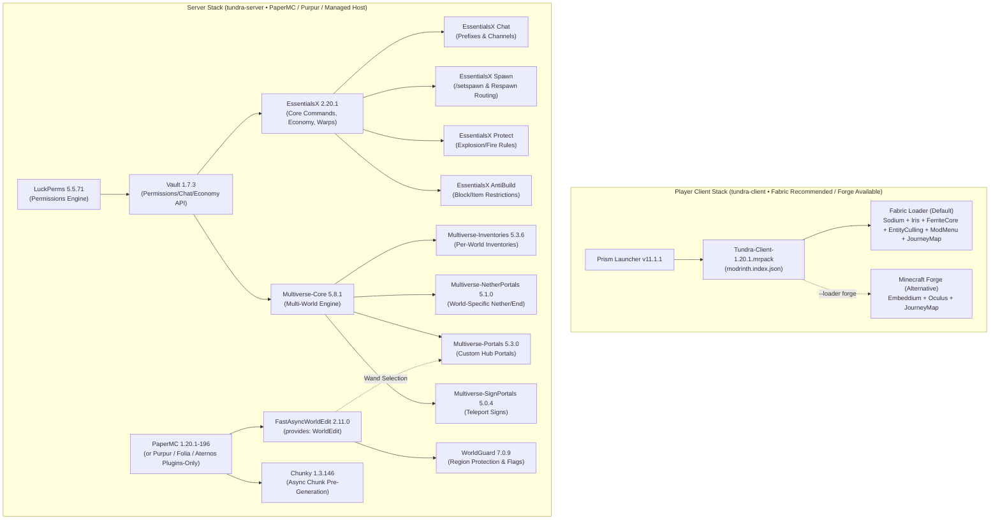

# Tundra

Declarative TOML package manifest, interactive **Server Configurator** (`tundra-server`), **Player Client Modpack Installer** (`tundra-client`), and `uv`-style compatibility/dependency resolver — part of the **Frost** ecosystem.

Built with **zero external Python dependencies** (pure Python 3.11+ standard library: `tomllib`, `urllib`, `hashlib`, `zipfile`) and **zero Nix requirement**, so it runs natively on classic Minecraft hosting environments (**Aternos**, **Exaroton**, **Pterodactyl** panels, Linux VPS) as well as player desktops (Windows, macOS, Linux).

---

## Two Dedicated Tools in One Repository

Tundra splits server administration and player onboarding into two focused interactive CLI tools (plus a unified `tundra` entrypoint), styled with the Frost ecosystem's terminal UI engine (`ui.py`):

| CLI Command | Badge | Who It's For | What It Does |
| :--- | :--- | :--- | :--- |
| **`tundra-server`**<br/>*(or `tundra server`)* | `🏔️ [tundra-server]` | **Server Admins** | Interactive configurator to pick the Minecraft version, server backend (**PaperMC**, **PurpurMC**, **Folia**, **Fabric**, or **Plugins-Only / Managed Host mode** for Aternos), toggle plugins, lock SHA256 hashes in [`tundra.toml`](./tundra.toml), and export `tundra-server-mc<ver>.tar.gz` or a panel-ready `plugins/*.jar` `.zip`. |
| **`tundra-client`**<br/>*(or `tundra client`)* | `🧊 [tundra-client]` | **Players Joining the Server** | Interactive menu to pick a client mod loader (**Fabric** recommended with **Sodium + Iris + FerriteCore**, or **Forge** with **Embeddium + Oculus**), toggle recommended client mods, and generate a one-click **Prism Launcher `.mrpack`**, `tundra-client-mc<ver>.tar.gz`, or install `.jar` files directly into `.minecraft/mods`. |
| **`tundra`** | `🏔️ [tundra]` | **Unified CLI** | Top-level dashboard, upstream compatibility auditor (`tundra resolve`), offline `.jar` manifest inspector (`tundra inspect-deps`), and separated server/client release archive builder (`tundra bundle`). |

---

## Architecture & Dependency Graph

By default, [`tundra.toml`](./tundra.toml) pins a battle-tested **Minecraft 1.20.1** stack:
- **Server (`server/` & `plugins/`):** **PaperMC `1.20.1-196`** with **FastAsyncWorldEdit (FAWE)**, **WorldGuard**, **Chunky**, **LuckPerms**, **Vault**, **EssentialsX**, and **Multiverse 5.x**.
- **Client (`client/`):** **Fabric Loader** (recommended default) with **Fabric API**, **Sodium**, **Iris Shaders**, **JourneyMap**, **FerriteCore**, **EntityCulling**, and **Mod Menu** (or **Minecraft Forge** with **Embeddium** + **Oculus** + **JourneyMap** via `tundra-client --loader forge`), packaged into `client/Tundra-Client-1.20.1.mrpack`.



---

## Quick Start

You can install `tundra` via `pip install -e .` (or `uv tool install .`) or run it directly with `python3 -m tundra` with zero third-party packages required:

```bash
# 1. Launch the interactive Server Configurator (pick Paper/Purpur/Aternos, MC version, & plugins)
tundra-server
# or without installing: python3 -m tundra server

# 2. Launch the interactive Player Client Installer (pick Fabric/Forge, toggle mods, build .mrpack)
tundra-client
# or without installing: python3 -m tundra client

# 3. Download & SHA256-verify all locked packages in tundra.toml and build Tundra-Client.mrpack
tundra sync

# 4. Build separated server & client release tarballs (or build just one side)
tundra bundle                  # -> tundra-server-mc<ver>.tar.gz + tundra-client-mc<ver>.tar.gz
tundra-server bundle           # -> tundra-server-mc<ver>.tar.gz (server + plugins only)
tundra-client bundle           # -> tundra-client-mc<ver>.tar.gz (client mods + .mrpack only)

# 5. Export a clean plugins .zip for drag-and-drop upload to Aternos / Pterodactyl panels
tundra-server export-zip

# 6. Switch client stack between Fabric (Sodium + Iris) and Forge (Embeddium + Oculus)
tundra-client sync --loader fabric
tundra-client sync --loader forge

# 7. Install client mod .jars directly into a standard ~/.minecraft/mods directory
tundra-client sync --mods-dir ~/.minecraft/mods
```

---

## Dependency & Compatibility Resolution ("`uv` for Minecraft")

Tundra automates both upstream registry resolution and offline binary `.jar` manifest inspection:

### 1. Upstream Registry Resolution (`tundra resolve`)
Queries the **Modrinth v2 Bulk API**, **PaperMC Fill v3 API**, **PurpurMC v2 API**, **Fabric Meta API**, and **Forge Promotions API** to verify:
- **Game Version & Loader Matrix:** Confirms every pinned package in [`tundra.toml`](./tundra.toml) supports the target Minecraft version and loader (`paper`/`purpur`/`spigot` on server, `fabric`/`forge` on client).
- **Typed Dependency Edges:** Validates `required` dependencies (`Iris` $\rightarrow$ `Sodium`, `WorldGuard` $\rightarrow$ `WorldEdit`, `Multiverse-*` $\rightarrow$ `Multiverse-Core`), virtual `provides` satisfaction (`FastAsyncWorldEdit` $\rightarrow$ `WorldEdit`), and `incompatible` conflicts.
- **Upgrade Simulation (`--mc <VERSION>`):** Preview upgrading the server to any newer Minecraft release before touching a single file:
  ```bash
  tundra resolve
  tundra resolve --mc 1.21.4
  ```

### 2. Offline `.jar` Manifest Inspection (`tundra inspect-deps`)
Streams `plugin.yml`, `paper-plugin.yml`, `fabric.mod.json` (including nested Jar-in-Jar bundles), and `META-INF/mods.toml` directly out of downloaded `.jar` files using Python's built-in `zipfile` module (no external `7z` or `unzip` required):
```bash
tundra inspect-deps
```

---

## Declarative Configuration (`tundra.toml`)

All stack settings and locked binary checksums live in [`tundra.toml`](./tundra.toml):

```toml
[general]
name = "Tundra"
mc_version = "1.20.1"
release_url = "https://github.com/SpanishSyntax/Tundra/releases/download/v2.0.0"

[server]
# Supported backends: "paper" (recommended), "purpur", "folia", "plugins-only", "fabric"
backend = "paper"
plugins = [
  "luckperms",
  "vault",
  "essentialsx",
  "essentialsx-chat",
  "essentialsx-spawn",
  "essentialsx-protect",
  "essentialsx-antibuild",
  "multiverse-core",
  "multiverse-inventories",
  "multiverse-netherportals",
  "multiverse-portals",
  "multiverse-signportals",
  "fastasyncworldedit",
  "worldguard",
  "chunky",
]

[client]
# Supported loaders: "fabric" (recommended: Sodium + Iris) or "forge" (Embeddium + Oculus)
loader = "fabric"
loader_version = "0.19.5"
include_prism_installer = true
prism_version = "11.1.1"
mods = [
  "fabric-api",
  "sodium",
  "iris",
  "journeymap",
  "ferrite-core",
  "entityculling",
  "modmenu",
]
```